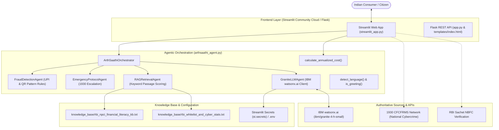

# ArthSaathi AI (अर्थसाथी)

**Digital Financial Literacy and UPI Fraud Awareness Platform**  
*IBM SkillsBuild AICTE Internship 2026 · Problem Statement No. 7*

ArthSaathi AI is an educational financial safety platform engineered for Indian citizens. It combines **IBM watsonx.ai Granite** foundation models with authoritative Reserve Bank of India (RBI) Master Directions and National Payments Corporation of India (NPCI) guidelines to detect cyber-fraud, evaluate high-interest loan offers, and provide emergency guidance during financial cyber incidents.

---

## 🌟 Key Features

1. **AI Scam Advisor (💬)**
   - Context-grounded advisory powered by IBM Granite (`ibm/granite-4-h-small`) with 50-second timeout resilience.
   - Grounded in local RBI/NPCI knowledge base passages with source citation and paragraph-level attribution.
   - Contextual fraud pattern detection for QR code scams (distinguishing dangerous receive-money scams from ordinary merchant payments) and UPI PIN/OTP requests.
   - Honest fallback mode: explicitly identifies whether responses originate from live IBM Granite or local offline knowledge base.

2. **Simplified Loan Cost Calculator (📊)**
   - Computes annualized borrowing costs: `((Repayment − Principal) / Principal) × (365 / Days) × 100`.
   - Identifies predatory interest rates exceeding RBI's 36% benchmark for regulated NBFCs.
   - Directly links to the official [RBI Sachet Portal](https://sachet.rbi.org.in) for lender verification.
   - Full input boundary validation with comprehensive error feedback.

3. **1930 Emergency Cybercrime Protocol (🚨)**
   - Actionable 5-step response protocol for fraud victims.
   - Immediate 1930 National Cybercrime Helpline call links triggering automated bank fund-freezes across 400+ banks via CFCFRMS.
   - Explains the RBI Zero-Liability Rule (Circular DBR.No.Leg.BC.78/09.07.005/2017-18) requiring reporting within 3 working days.
   - Directory with one-click access to cybercrime.gov.in, RBI Ombudsman (14448), and NPCI dispute portals.

4. **Vernacular Multilingual Support (🌐)**
   - Native support for **English**, **हिन्दी (Hindi)**, **मराठी (Marathi)**, and **Hinglish** (Latin-script transliterated Hindi).
   - Conversational continuity: short acknowledgments ("ok", "thanks") preserve the established language.
   - Deterministic greetings and system-prompt directives in Devanagari and Latin scripts.

5. **Editorial Finance Design System & Light/Dark Theme (🌓)**
   - Professional, editorial typography with deep navy (`#1B365D`), slate backgrounds, and high-contrast alert callouts.
   - Stateful light/dark mode selector.
   - Fully responsive desktop and mobile workspace.

---

## 🏗️ System Architecture



---

## 📁 Repository Structure

```
ArthSaathi-AI/
├── streamlit_app.py          # Primary Streamlit application entry point
├── app.py                    # Flask web application & REST API
├── arthsaathi_agent.py       # Framework-independent agent orchestration core
├── requirements.txt          # Production dependencies (Streamlit, Flask, IBM SDK)
├── render.yaml               # Render Blueprint deployment definition
├── .env.example              # Environment template for local development
├── .gitignore                # Protects .env and .streamlit/secrets.toml
├── .streamlit/
│   ├── config.toml           # Theme configuration (editorial styling)
│   └── secrets.toml.example  # Template for Streamlit Community Cloud secrets
├── knowledge_base/
│   ├── rbi_npci_financial_literacy_kb.txt  # Curated RBI & NPCI consumer rules
│   └── rbi_whitelist_and_cyber_stats.txt   # NBFC whitelisting and fraud stats
├── templates/
│   └── index.html            # Flask HTML5 template
├── static/
│   ├── css/styles.css        # Editorial stylesheet
│   └── js/app.js             # Client-side chat and API integration
└── tests/
    ├── test_streamlit_app.py # 22 automated tests for Streamlit application
    └── test_app.py           # 77 automated tests for Flask & core agents
```

---

## 🚀 Quickstart & Local Setup

### 1. Prerequisites
- Python 3.10 to 3.12
- Git
- (Optional) IBM Cloud Account with watsonx.ai Machine Learning instance

### 2. Clone and install
```bash
git clone https://github.com/TERMINATOR7732/ArthSaathi-AI.git
cd ArthSaathi-AI
pip install -r requirements.txt
```

### 3. Local Secrets Configuration
For Streamlit development:
```bash
cp .streamlit/secrets.toml.example .streamlit/secrets.toml
# Edit .streamlit/secrets.toml with your IBM watsonx.ai credentials
```

For general environment variables:
```bash
cp .env.example .env
# Edit .env with your IBM watsonx.ai credentials
```

Required credentials:
- `WATSONX_API_KEY`: IBM Cloud IAM API Key
- `WATSONX_PROJECT_ID`: watsonx.ai Project GUID
- `WATSONX_URL`: `https://us-south.ml.cloud.ibm.com`
- `WATSONX_MODEL_ID`: `ibm/granite-4-h-small`

*(Note: If credentials are not provided, ArthSaathi operates cleanly in offline mode with curated RBI/NPCI guidelines).*

### 4. Run the Streamlit Application
```bash
streamlit run streamlit_app.py
```
Open [http://localhost:8501](http://localhost:8501) in your browser.

### 5. Run the Flask Application (Alternative)
```bash
python app.py
```
Open [http://localhost:5000](http://localhost:5000) in your browser.

---

## 🧪 Automated Testing

ArthSaathi AI maintains an extensive test suite with **99 automated test cases** (77 core/Flask tests and 22 Streamlit app tests):

```bash
# Run the complete test suite
pytest tests/ -v
```

Test suite coverage:
- Streamlit page rendering, sidebar controls, and tab navigation.
- Missing credentials and honest offline degradation.
- Mocked IBM Granite success, error, and timeout paths.
- RAG keyword retrieval, citation indices, and boundary cases.
- Vernacular language matrix (English, Hindi, Marathi, Hinglish).
- UPI QR scan-to-receive fraud detection & negative merchant payment guards.
- 1930 Cybercrime protocol escalation.
- Loan APR calculator mathematical precision and boundary validation.
- Session state persistence and chat history reset.

---

## ☁️ Deployment Guide: Streamlit Community Cloud

ArthSaathi AI is designed for 1-click deployment on **Streamlit Community Cloud** on the 100% free tier.

### Deployment Steps:
1. Log in to [share.streamlit.io](https://share.streamlit.io/) with your GitHub account.
2. Click **New app**.
3. Select your repository: `TERMINATOR7732/ArthSaathi-AI`.
4. Branch: `main`.
5. Main file path: `streamlit_app.py`.
6. Click **Advanced settings...** and paste your secrets in the **Secrets** text area:
   ```toml
   WATSONX_API_KEY = "your_actual_ibm_api_key"
   WATSONX_PROJECT_ID = "your_actual_watsonx_project_guid"
   WATSONX_URL = "https://us-south.ml.cloud.ibm.com"
   WATSONX_MODEL_ID = "ibm/granite-4-h-small"
   ```
7. Click **Deploy!**
8. The app will build and deploy at your custom `*.streamlit.app` URL.

---

## 🎯 Competition Demonstration Flow

Follow this concise sequence when evaluating ArthSaathi AI:

1. **System Health Check**:
   - Inspect the sidebar status pill: confirms live connection to `ibm/granite-4-h-small` or offline RBI/NPCI knowledge base.
2. **Contextual UPI Fraud Shield**:
   - Ask: *"Someone sent me a QR code and told me to scan it to receive money. Should I?"*
   - Verify: Critical alert immediately warns that scanning a QR code only sends money, never receives it.
3. **Emergency Escalation (1930 Protocol)**:
   - Ask: *"I was scammed and money was stolen from my account, help me!"*
   - Verify: Triggers the 1930 National Cybercrime Helpline protocol, cybercrime.gov.in online FIR guide, and RBI 3-day zero liability notification.
4. **Multilingual Proficiency**:
   - Hindi: *"क्या बैंक कभी मुझसे यूपीआई पिन मांग सकता है?"*
   - Marathi: *"मला सांगा यूपीआई पिन कसा बदलायचा?"*
   - Hinglish: *"bhai mera paisa kat gaya ab kya karu?"*
5. **Loan APR Analysis**:
   - Navigate to Tab 2 (**Loan Cost Calculator**).
   - Enter Principal: ₹10,000 | Repayment: ₹12,500 | Tenure: 15 Days.
   - Result: 608.33% annualized cost — flagged with predatory warning and link to RBI Sachet portal.
6. **Theme & Display**:
   - Toggle between **Light** and **Dark** themes in the sidebar to verify visual contrast and accessibility.

---

## ⚖️ Responsible Use & Legal Disclaimer

ArthSaathi AI is an educational technology demonstration developed for the IBM SkillsBuild AICTE Internship 2026. It provides public financial literacy and cyber-safety awareness based on published RBI and NPCI circulars. **It does not provide licensed legal, investment, or banking counsel.** For active cyber-fraud incidents, citizens must immediately call **1930** and report to local law enforcement authorities.

---

## 📜 License

Distributed under the MIT License. See [LICENSE](LICENSE) for details.
